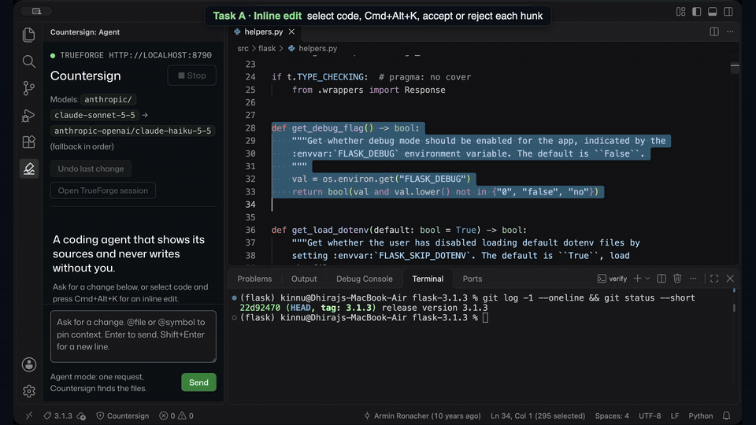

# Countersign

A coding agent for VS Code. You ask for a change; it finds the files itself and tells you why it picked each one; then every edit waits for you to accept or reject it, hunk by hunk. Nothing is written until you do.

**Why it needs TrueForge:** Countersign has no agent loop of its own. It runs on [TrueForge](https://github.com/truefoundry/trueforge), TrueFoundry's open-source agent harness, which you start locally with one `npx` command. TrueForge runs the model, the tool loop and the subagents; Countersign hands it the editor as tools, and each edit the agent wants to make reaches you as a TrueForge approval that opens as a review in the editor.



What the 3:17 demo video shows, on pallets/flask 3.1.3, each step checked in the terminal on screen:

| Time | What you see |
|---|---|
| 0:05 | **Task A, inline edit.** `Cmd+Alt+K` on `get_debug_flag`; two hunks, each accepted on its own; `FLASK_DEBUG=off` then prints `False` |
| 0:27 | **Undo.** "Undo last change" restores the file; `git status` is clean |
| 0:32 | **Task B, agent mode.** One request, no files named. The Context card (0:39) shows 9,653 of 10,000 tokens used and why each file was chosen; a context-scout subagent explores; 5 files arrive as a per-hunk review; `63 passed`; `flask config` prints masked JSON |
| 2:20 | **TrueForge session** for Task B: 1 turn, 24 tool calls, 1 sub-agent, approval pauses on the timeline |
| 2:32 | **Task C, model failure.** First model unreachable: 2 retries with backoff (0.8 s, 1.6 s), then the next model takes over with no click; `git status` shows no files changed before accept |
| 3:03 | **Stop** mid-answer: the TrueForge turn is cancelled and `git status` stays clean |

**Measured, back-test on public data (pallets/flask history, 2021-2026):** for 21 of 79 held-out Flask commits, every file the commit edited landed in Countersign's 10,000-token context pack, against 11 of 79 for whole-file BM25 as used in SWE-bench (paired difference +0.127, 95% interval 0.025 to 0.228). No real users yet. Details and rerun command under [Evidence](#evidence).

It was built for the TrueFoundry Forge-a-thon, whose three fixed tasks on pallets/flask are described [below](#the-three-fixed-tasks-palletsflask-313).

## Try it

You need Node 22 or 24, VS Code 1.95+, git, and an API key for a model provider (or [Ollama](https://ollama.com) for a free local model). For the Flask tasks: Python 3.12 and [uv](https://docs.astral.sh/uv/).

```bash
git clone https://github.com/kinnuworks/countersign && cd countersign
npm ci && npm run build
```

1. **Start TrueForge locally** (keep it running):

   ```bash
   OUTBOUND_URL_ALLOWED_HOSTS='["127.0.0.1","localhost"]' npx @truefoundry/trueforge@latest
   ```

   `OUTBOUND_URL_ALLOWED_HOSTS` is TrueForge's own setting. Countersign's MCP server listens on 127.0.0.1, which TrueForge blocks by default. Use Node 22 or 24 for TrueForge: on Node 26 its bundled HTTP client crashes with `setTypeOfService EINVAL`.

2. **Configure models in TrueForge.** Either open http://localhost:8790 → Settings → Models, or:

   ```bash
   cp countersign.models.example.json countersign.models.json   # edit "chain" to taste
   ANTHROPIC_API_KEY=... npm run setup
   ```

   The setup script creates the providers listed in `countersign.models.json` inside TrueForge. Keys go to TrueForge and are never written to this repo. `chain` is the fallback order: the first model runs, and the next one takes over when it fails.

3. **Load the extension**: open this folder in VS Code and press F5 ("Run Countersign"), or `npm run package` and `code --install-extension countersign-0.1.0.vsix`.

4. **Open a project** in that window. Countersign registers its MCP servers and saves the two agent definitions (`agent/*.json`) in TrueForge, so they show under Agents. The dot in the Countersign panel turns green when it is connected.

For the hackathon's fixed tasks, `scripts/prepare-flask.sh ~/flask` gives you pallets/flask 3.1.3 (commit 22d92470) with its locked test dependencies in `.venv`.

## Use it

- **Inline edit:** select code, press `Cmd+Alt+K` (`Ctrl+Alt+K`), type the instruction. The proposal opens in a diff with Accept and Reject on every hunk, both in the editor (CodeLens) and in the panel.
- **Agent mode:** type a request in the Countersign panel. Name files or symbols with `@` if you want; otherwise the retriever and a context-scout subagent find them. The panel shows the context it chose (files, reasons, token budget), the subagent, each tool call, and streaming text.
- **Review:** each write arrives as a TrueForge approval. Accept or reject per hunk, per file, or all. Rejected hunks are reported back to the model, so it knows exactly what landed.
- **Stop:** `Esc` or ■ Stop cancels the TrueForge turn at once and drops open reviews. Writes happen only inside an approved, complete tool call, so a cancelled run never leaves a half-applied edit.
- **Undo:** "Undo last change" restores the last applied change set (and refuses if you edited those files since).
- **When a model fails:** network, rate-limit and server errors are retried with exponential backoff, then the next model in the chain takes over with no click. Auth errors skip the retries.

## The three fixed tasks (pallets/flask 3.1.3)

| Task | What you do | How to check |
|---|---|---|
| A. Inline edit | Select `get_debug_flag` in `src/flask/helpers.py`, `Cmd+Alt+K`, give the instruction, accept | `FLASK_DEBUG=off python -c "from flask.helpers import get_debug_flag; print(get_debug_flag())"` prints `False` |
| B. Agent mode | In the panel, with no files named, ask for the `flask config` command, review the hunks, accept, allow the test run | `pytest tests/test_cli.py -q` passes; `flask --app <app> config` prints masked JSON; the diff touches 3+ files; "Open TrueForge session" shows turns and tool calls |
| C. Resilience | Break the first model's provider inside TrueForge: `npm run setup -- --break-endpoint anthropic` points it at an address nothing listens on (or edit it in TrueForge → Settings → Models). Repeat Task A. `npm run setup -- --restore anthropic` afterwards | the editor stays responsive, the panel shows two retries with backoff and the switch to the next model in the chain, `git status` shows no files changed before you accept |

## How it uses TrueForge

| TrueForge feature | What it does here | Code |
|---|---|---|
| Sessions, streamed turns, cancel (TypeScript SDK) | every agent and inline run; tokens render as they arrive; Stop calls `sessions.cancel` | [src/core/forge.ts](src/core/forge.ts) |
| Remote MCP servers | the editor's capabilities as tools: `retrieve_context`, `read_file`, `list_files`, `search_code`, `find_symbol`, `repo_map`, `propose_edit`, `create_file`, `run_command` (127.0.0.1, per-launch bearer token) | [src/core/tools.ts](src/core/tools.ts) |
| Tool approval (`require_approval_for_tools`) | writes and commands pause the turn; the pause opens the per-hunk review; the answer goes back as `user.tool_approval`, with the rejected hunks named in the reason | [src/extension/extension.ts](src/extension/extension.ts), [src/core/proposals.ts](src/core/proposals.ts) |
| Subagents (`dynamic_sub_agents`) | a `context-scout` subagent explores the repo and reports the files, line ranges and patterns to follow before any edit | [agent/countersign-coder.json](agent/countersign-coder.json) |
| Deferred tool loading (`preload: false`) | the `countersign-extras` server (git status, git diff, applied changes) is discovered on demand through TrueForge's meta tools | [agent/countersign-coder.json](agent/countersign-coder.json) |
| Compaction | on at 60k input tokens for long agent runs | [agent/countersign-coder.json](agent/countersign-coder.json) |
| Model catalog and custom OpenAI-compatible providers | every model is configured in TrueForge; the extension never calls a provider | [scripts/setup.ts](scripts/setup.ts), [countersign.models.example.json](countersign.models.example.json) |

## How context is chosen

The retriever ([src/core/retriever.ts](src/core/retriever.ts)) splits files into symbol-sized chunks (Python functions and classes, doc sections, line windows) and ranks them with BM25 plus four rules:
- it drops words that appear everywhere (the project's own name, say);
- it rewards files that cover more of the request, weighted by how rare each word is;
- it gives the best code, test and doc file a slot each when the request asks for tests or docs, and prefers tests and docs that belong to the chosen code (tests that import it, docs with the same name);
- it follows the import graph from the top files.

It packs the best chunks, with each file's outline and the reason it was chosen, until a token budget (10,000 by default) is used, and lists what it left out. The agent can call `retrieve_context` and `search_code` for more. `@file` and `@symbol` mentions are pinned first.

## Check it yourself

First get Flask with its full history, which the retriever tests, the end-to-end script and the back-test read: `git clone https://github.com/pallets/flask .ref/flask && git -C .ref/flask checkout -q 3.1.3` (or point `FLASK_DIR` at a checkout you have). Without it, the two retriever tests skip and say why.

- `./check.sh`: typecheck, unit tests, and `scripts/e2e.sh`, which starts a real VS Code with the extension against your running TrueForge on a fresh Flask 3.1.3. It runs Task A (review, accept, verify), undo, Stop in the middle of an agent run, and Task C with an unreachable first model.
- `node out/harness.js --repo <flask> --task B`: the same core, headless, with an auto-reviewer.
- `node out/replay.js <flask-git-dir>`: the retrieval back-test below.

## Evidence

Evidence, stated plainly: no real users yet; it was built for this hackathon. Instead: a back-test on pallets/flask history against SWE-bench's BM25 retriever, and our own break test of the three fixed tasks. Each one reruns from the repo with one command.

> **Claim:** Countersign's retriever fits every file a real Flask change edited into its 10,000-token pack more often than BM25 over whole files.
> **Evidence type:** Back-test on public data (pallets/flask history, 2021-2026), not real users.
> **Data:** pallets/flask git history (BSD-3), commits from 2021-05-11 to 3.1.3 that edit 2 to 8 existing text files; the commit message is the request. Test slice 2023-01-01 to 2026-02-18, n=79 commits (plan committed before the first run: [evidence/EVAL_PLAN.md](evidence/EVAL_PLAN.md)). **Baseline:** BM25 whole-file retrieval as in SWE-bench (Jimenez et al., ICLR 2024), run by us on the same commits.
> **Result:** 21 of 79 = 26.6% (95% interval 18.1% to 37.2%) vs 11 of 79 = 13.9% (8.0% to 23.2%); paired difference +0.127 (0.025 to 0.228). Across all 197 commits: 69 vs 23.
> **Rerun:** `node out/replay.js .ref/flask` at commit 0a0ac4e. **Limits:** commit messages stand in for user requests. Ranking alone is level with BM25 (mean recall of edited files in the top 5: 0.424 vs 0.441, difference -0.017, interval -0.088 to 0.053); the gain comes from packing symbol chunks instead of whole files.

> **Claim:** the three fixed tasks run in the real editor against a real TrueForge.
> **Evidence type:** Our own break test (we tried to make it fail), not real users.
> **Result:** `scripts/e2e.sh` passed: Task A verified, undo restored a clean `git status`, Stop cancelled in 203 ms with no files changed, and Task C fell back after 3 failed attempts on the unreachable endpoint.
> **Rerun:** `scripts/e2e.sh`. **Limits:** one machine, one model chain.

> **Claim:** the fixed tasks pass on more than one model, headless, with the checks the video uses.
> **Evidence type:** Our own break test (we tried to make it fail), not real users.
> **Result** (`evidence/results/matrix.csv`): Claude Sonnet 5.5 passes A and B (B changed 5 files); Claude Haiku 5.5 passes A and B (3 files); Haiku through the OpenAI-compatible endpoint passes A; gemma4 e4b (local, Ollama) fails A.
> **Rerun:** `scripts/matrix.sh "<model> ..."`. **Limits:** one run per model and task.

Limits, in numbers: zero real users. The back-test's 95% interval on the gain is 0.025 to 0.228, so the size of the gain is uncertain; the data is Flask's own history from 2021 to 2026, one Python project, with commit messages standing in for requests. The next real test is the same replay on a second Python project and on real typed requests; the claim would change if the paired difference's interval included zero there.

## What doesn't work yet

- The extension is not on the Marketplace (out of scope); load it with F5 or the `.vsix`.
- TrueForge allows one native Anthropic provider, so the example chain's fallback is Claude Haiku through Anthropic's OpenAI-compatible endpoint, registered as a separate custom provider. A broken native provider then still leaves a working model. For an invalid key instead of an unreachable endpoint: `npm run setup -- --break-key anthropic`.
- A small local model (gemma4 e4b on Ollama) did not finish Task A on our Mac: its output was cut off after about 3 minutes (see the model matrix below). Larger local models should do better; we did not test them.
- Retrieval understands Python structure best; other languages are chunked by line windows.
- A rejected hunk is not re-proposed automatically; the model is told, and you can ask again.

## Starting point

From scratch: no upstream fork. Libraries used: `@truefoundry/trueforge-sdk`, `@modelcontextprotocol/sdk`, `diff` (jsdiff), `zod`.

## Licence

MIT, see [LICENSE](LICENSE).
